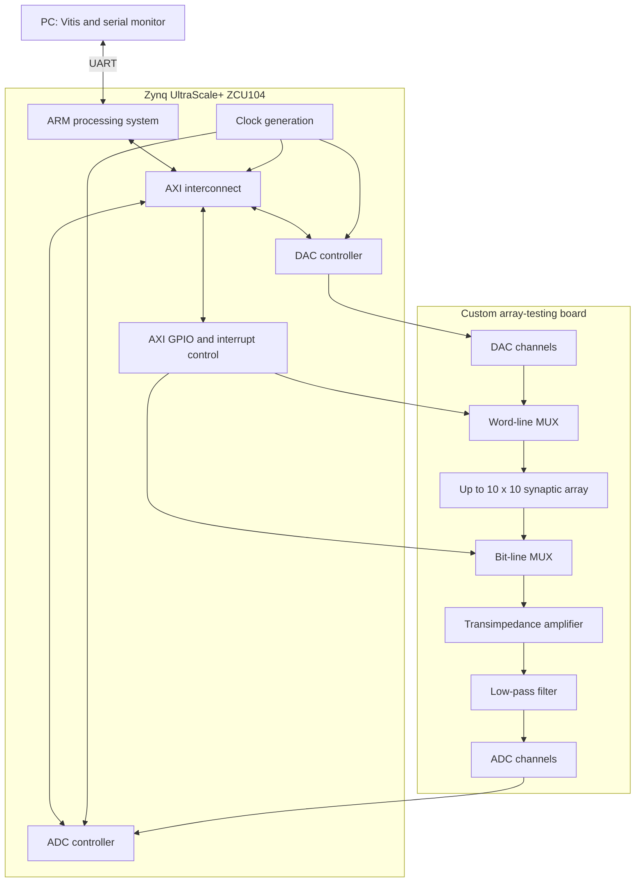

# System Architecture

## Overview

The research platform combines three physical layers:

1. a PC running Vitis and a serial terminal;
2. a Zynq UltraScale+ ZCU104 SoC development board containing an ARM processing system and FPGA programmable logic;
3. a custom array-testing board connected to an FTJ device array.

## Layer responsibilities

| Layer | Responsibility |
|---|---|
| PC / Vitis | Builds and loads the embedded application; monitors results over UART |
| ARM processing system | Runs the command interface, experiment orchestration, calibration, and higher-level computation |
| FPGA programmable logic | Provides AXI-connected GPIO, DAC/ADC control, clocks, and board-facing timing logic |
| Array-testing board | Generates analog word-line voltages, selects rows and columns, and digitizes bit-line currents |
| FTJ array | Stores nonvolatile conductance values and performs physical current accumulation |

## Control path

The surviving C program initializes four GPIO blocks:

- LED/debug output;
- bit-line write selection (`BL_WR`);
- bit-line read selection (`BL_RD`);
- word-line write/read selection (`WL_WR_RD`).

PCA9535 I/O expanders configure additional MUX states. Custom `DacCtrl` and `AdcCtrl` interfaces expose FPGA-side control registers and data acquisition to the ARM software.

## Analog data path

For a selected word line, a DAC converts a digital code into an analog voltage. Row MUXes connect the active or inactive voltage path to the FTJ array. A selected bit-line current passes through a transimpedance amplifier and low-pass filter before the ADC measures the resulting voltage.

For column \(j\):

\[
I_j = \sum_i G_{ij}V_i
\]

and the transimpedance stage gives:

\[
V_{ADC,j}=R_F I_j
\]

The patent describes 1 kOhm and 1 MOhm feedback ranges for mA- and microamp-scale measurements respectively.

## Known platform characteristics

The associated article and patent document the following configuration:

| Item | Documented value |
|---|---|
| Development board | AMD/Xilinx ZCU104, XCZU7EV device |
| Maximum demonstrated array addressing | 10 word lines x 10 bit lines |
| DAC | 14-bit AD5446 |
| ADC | 18-bit AD4003 |
| Minimum documented DAC pulse width | 500 ns |
| Maximum documented pulse amplitude | +/-10 V |
| Bus, DAC, ADC clocks in patent example | 100 MHz, 48 MHz, 24 MHz |

These values describe the reported research prototype. They are not a substitute for the missing Vivado block design, board schematic, calibration files, or component-level test procedure.

## Read, write, and compute modes

### Device read

1. Select one word line and one bit line.
2. Apply a low read voltage within the approximately linear I-V region.
3. Measure the bit-line current through the TIA/ADC path.
4. Convert the result to conductance after calibration and baseline correction.

### Device programming

1. Select the target device through word-line and bit-line MUXes.
2. Apply a positive or negative write pulse.
3. Use inactive lines at a half- or third-select voltage where appropriate to reduce disturbance.
4. Read the conductance and repeat until it falls within the target tolerance.

### Parallel compute

1. Store weights as FTJ conductances.
2. Apply multiple input voltages simultaneously to the word lines.
3. Measure the accumulated current on the selected bit line.
4. Apply digital scale and offset correction to recover a dot product or convolution output.

